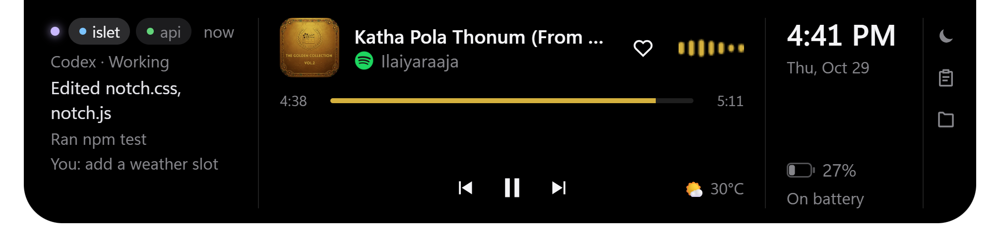
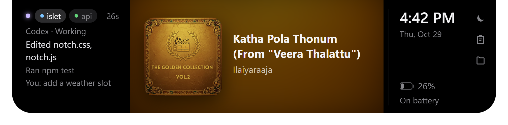

<h1 align="center">Islet</h1>

<p align="center">
  A Dynamic-Island-style notch for <b>Windows 11</b>.<br>
  Music, Claude Code and Codex activity, notifications, time and battery, at the top of your screen.
</p>

<p align="center">
  
</p>

<p align="center">
  <a href="LICENSE"></a>
  
  
</p>

Islet sits at the top centre of the screen as a small pill. Hover it to open it.

| Pill | Notification | Album view |
|:---:|:---:|:---:|
|  |  |  |

**Layout of the open notch, left to right:**
- **Agent column:** Claude Code and Codex sessions.
- **Music:** the player and its controls.
- **Time and battery:** clock, date, battery level and charging state.
- **Tools:** Do Not Disturb, clipboard history and the file shelf.

## Features

| Area | What it does |
|---|---|
| Music | Spotify (or any player that uses Windows media controls): art, title, seek, prev/play/next, like (Alt+Shift+B), scroll to change Spotify's own volume, a live wave from Spotify's audio only, timed lyrics from lrclib.net, an enlarged album view |
| Claude Code and Codex | Both in one column, newest first, switching on its own: status per session (working / needs you / done), the last 3 actions, Allow / Deny for Claude Code permission requests from the notch, click a project to open its folder |
| Notifications | Every Windows toast becomes a notch pop-up with the real app logo. Windows' own bottom-right banners are turned off while Islet runs and restored when it quits. Clicking a pop-up opens the app. Do Not Disturb with an optional daily schedule |
| Time and battery | Own column on the right: clock, date, battery level, charging state, mic / camera / screen-capture dots. Hides during fullscreen apps |
| Info | Weather (Open-Meteo, no key), the next calendar event (private ICS link), browser download progress, a timer |
| Tools | Clipboard history (memory only), a file shelf (drop files in, drag them out) |

## Requirements

- Windows 10 1903+ or Windows 11 (uses Windows media controls, process-loopback audio and the notification database)
- Node.js 20+ and npm
- Git
- Windows PowerShell 5.1 (built into Windows; the helpers use it)

## Quick start

```powershell
git clone https://github.com/goprocker/Islet.git
cd Islet
npm install
npm start
```

The notch appears at the top of your primary screen, and Islet adds itself to "Start with Windows" on first run. Right-click the tray icon for the menu, or open **Settings…**.

### Build an installer (optional)

```powershell
npm run dist      # -> dist\Islet Setup <version>.exe
```

The build is unsigned. With **Smart App Control** on, Windows blocks unsigned installers; run from source with `npm start`, or sign the build with your own certificate.

## Usage

| Action | How |
|---|---|
| Open / close | Hover the notch, or `Ctrl+Alt+N` (pill → open → hidden) |
| Move to another monitor | `Ctrl+Alt+M` (next screen), or tray → **Show on screen** |
| Volume | Scroll over the music side |
| Seek | Click the progress bar |
| Album view | Click the album art |
| Clipboard / shelf / Do Not Disturb | Buttons in the tools column on the right |
| Settings | Tray → **Settings…** (writes `%APPDATA%\islet\config.json`) |

## Claude Code integration

Tray → **Connect to Claude Code and Codex** adds hooks to `~/.claude/settings.json` (a backup is saved as `settings.json.islet-backup`). The hook script `hooks/islet-hook.js` POSTs each event to `127.0.0.1:47321/claude`:

- `UserPromptSubmit`, `PostToolUse` → working, latest actions
- `Notification`, `PermissionRequest` → needs you; the notch shows Allow / Deny
- `Stop`, `SessionEnd` → done

A permission request is held for `permissionWaitSeconds` (default 8). If you don't answer in the notch, Claude Code asks in the terminal as usual. Set it to 0 to never hold. Untick the menu item to remove the hooks.

Without hooks, Islet falls back to guessing the status from the newest transcript in `~/.claude/projects`.

### Codex

If `~/.codex` exists, the same menu item (**Connect to Claude Code and Codex**) also adds hooks to `~/.codex/hooks.json` (backup: `hooks.json.islet-backup`), calling `islet-hook.js <Event> codex` for `SessionStart`, `UserPromptSubmit`, `PermissionRequest`, `PostToolUse`, `Stop` and `SessionEnd`. Other hooks in that file are kept.

- Claude and Codex sessions share the column. The newest one is shown, and one that needs you jumps to the front. With both around, the status line says `Claude ·` or `Codex ·`, and Codex chips have a blue dot.
- Codex actions come from the hooks: your prompt, tools used (`apply_patch` shows the edited files) and the final message.
- Codex permission requests show "Needs you", but you answer them in Codex; Islet never holds them.
- Codex asks you to trust new hooks before running them. Approve Islet's once, through the prompt Codex shows or `/hooks`.

## Settings

All keys live in `%APPDATA%\islet\config.json` and are edited from the settings window. Hand edits are picked up within 2 s.

| Key | Default | Meaning |
|---|---|---|
| `size` | `normal` | `compact`, `normal` or `large` |
| `accent` | `album` | `album` (colour from the art) or `#rrggbb` |
| `idleHide` | `false` | Shrink to a thin line when nothing is happening |
| `hideInFullscreen` | `true` | Hide while a fullscreen app is in front |
| `notifications` | `true` | Show Windows notifications in the notch |
| `hideWindowsBanners` | `true` | Turn off Windows' bottom-right banners while Islet runs |
| `dnd`, `dndFrom`, `dndTo` | off | Do Not Disturb, with an optional daily `HH:MM` window |
| `permissionWaitSeconds` | `8` | How long to hold a permission request for Allow / Deny (0–24) |
| `lyrics` | `true` | Fetch lyrics from lrclib.net |
| `weatherCity` | `""` | e.g. `Chennai`; empty turns weather off |
| `weatherUnit` | `C` | `C` or `F` |
| `calendarIcsUrl` | `""` | Private iCal link |
| `downloadsFolder` | `""` | Empty means your Downloads folder |
| `clipboardHistory` | `true` | Keep the last 5 copied texts in memory |
| `displayId` | `null` | Screen to show on (set by `Ctrl+Alt+M` or the tray) |
| `spotifyClientId` | `""` | Optional Spotify Web API (Premium only) |

## How it works

```
main.js ── window, tray, settings, IPC
 ├─ media.ps1             Windows media session → JSON every second; play/seek/next
 ├─ spotify-audio.ps1/.cs process-loopback capture of Spotify → 24 FFT bands, volume
 ├─ system.ps1            mic / camera / screen use (registry), fullscreen detection
 ├─ notifications.js      polls wpndatabase.db (node:sqlite, read-only); toggles banners
 ├─ icons.js              real app logos (Store manifests, shortcuts, exe icons)
 ├─ claude-bridge.js      HTTP server for Claude Code + Codex hooks; installs/removes them
 ├─ calendar.js  weather.js  lyrics.js  downloads.js  spotify-web.js
 └─ preload.js ── renderer/  (index.html, notch.css, notch.js)
                  settings/  (settings window)
```

- The window is frameless, transparent and always on top. It ignores the mouse except while the pointer is over the notch.
- C# runs through `Add-Type` inside PowerShell, so no unsigned exe ships (works with Smart App Control on).
- Windows has no notification-listener API for unpackaged apps, so Islet reads the notification database read-only.
- Banners are hidden by setting `ShowBanner = 0` under `HKCU\Software\Microsoft\Windows\CurrentVersion\Notifications\Settings\<app id>`. The previous values are saved in `%APPDATA%\islet\banners.json` and put back on quit, or when the setting or notifications are turned off. Notifications still reach the notification centre.

### Debugging

```powershell
node_modules\electron\dist\electron.exe . --remote-debugging-port=9333
```

Then open `chrome://inspect`, or drive the page over the DevTools protocol. Useful page globals: `setOpen(true)`, `render()`.

## Privacy

Everything runs locally. Network calls: lrclib.net (title and artist, when lyrics are on), Open-Meteo (the city name), your ICS link, and the Spotify API only if you connect it. Clipboard history is never written to disk; the shelf stores file paths only.

## Uninstall

1. Tray → untick **Connect to Claude Code and Codex** and **Start with Windows**.
2. Tray → **Quit** (puts Windows banners back).
3. Delete the folder and `%APPDATA%\islet`.

## Contributing

Issues and pull requests are welcome. Keep changes small, use [Conventional Commits](https://www.conventionalcommits.org/), and say how you tested.

## License

[MIT](LICENSE)
