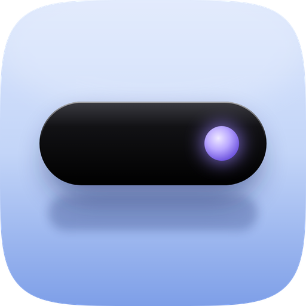
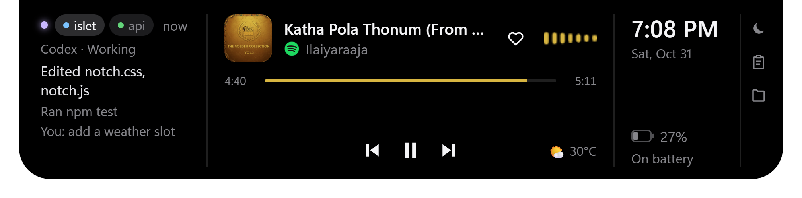
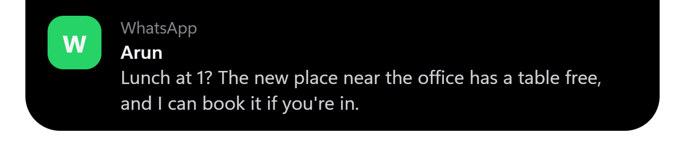
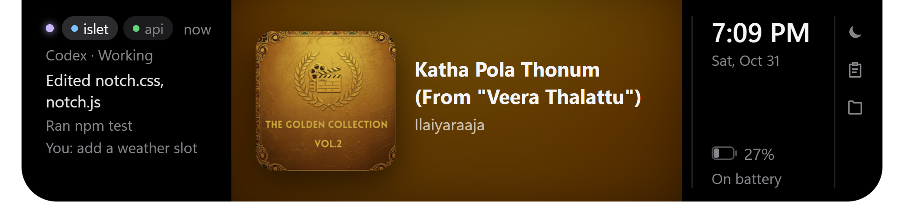
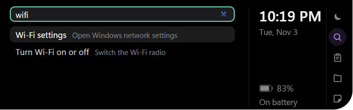

<div align="center">



# Islet

### The notch Windows never had.

A Dynamic-Island-style pill at the top of your screen for **music**, **Claude Code and Codex**, **notifications**, **battery**, **search** and a dock of small tools. Free, open source, one installer.

<br>

<a href="https://github.com/goprocker/Islet/releases/latest"></a>
<a href="https://islet.loopfound.in"></a>
<a href="Islet-Guide.pdf"></a>

<a href="https://github.com/goprocker/Islet/releases/latest"></a>
<a href="LICENSE"></a>


<br><br>



<br><br>

<table>
  <tr>
    <td align="center"><br><sub><b>Pill</b><br>quiet until it matters</sub></td>
    <td align="center"><br><sub><b>Notifications</b><br>real app logos, full text</sub></td>
    <td align="center"><br><sub><b>Album view</b><br>with timed lyrics</sub></td>
  </tr>
  <tr>
    <td align="center" colspan="2"><br><sub><b>Search</b> · Alt+Space</sub></td>
    <td align="center"><br><sub><b>Volume HUD</b><br>brightness and mic too</sub></td>
  </tr>
</table>

<br>

<table>
  <tr>
    <td align="center"><kbd>Alt</kbd> + <kbd>Space</kbd><br><sub>Search</sub></td>
    <td align="center"><kbd>Ctrl</kbd> + <kbd>Alt</kbd> + <kbd>N</kbd><br><sub>Pill / open / hidden</sub></td>
    <td align="center"><kbd>Ctrl</kbd> + <kbd>Alt</kbd> + <kbd>M</kbd><br><sub>Next monitor</sub></td>
    <td align="center"><kbd>Alt</kbd> + <kbd>Shift</kbd> + <kbd>B</kbd><br><sub>Like on Spotify</sub></td>
  </tr>
</table>

<br>

[**Features**](#-features) · [**Dock and pet**](#-the-dock-and-the-pet) · [**Install**](#-install) · [**Usage**](#%EF%B8%8F-usage) · [**Claude Code & Codex**](#-claude-code-and-codex) · [**Settings**](#%EF%B8%8F-settings) · [**How it works**](#-how-it-works)

</div>

---

> [!TIP]
> **Hover to open it, click anywhere else to close it.** When nothing is happening Islet shrinks to a plain black pill with one dot.

The open notch, left to right: **agent sessions** → **music** → **time and battery** → **tools**.

## ✨ What's new

| | |
|---|---|
| 🐾 **2.3: bring your own pet** | Load any pet in the Codex Pets format. The pet talks in the closed pill, codes along with your agent, asks when it needs you and plants a flower after focus sessions. |
| 📱 **2.2: dock and Phone drop** | A dock with Phone drop, Links, World clock, Clipboard, Notes, Timer, Shelf, Weather, Units, System and AI coding. Scan a QR code to move files between phone and PC over Wi-Fi. |
| 🔎 **Search** | `Alt+Space` finds apps, files, folders, Wi-Fi and Bluetooth switches, settings, clipboard items and notes. |
| 🍅 **Focus tools** | Pomodoro and stopwatch from the tray. Do Not Disturb turns on by itself during focus. |
| 🔊 **Volume, brightness and mic HUD** | Level bars and clean icons in the notch; a muted mic gets its own red toast. |
| 🌌 **Black hole charger animation** | Interstellar-style, when the charger goes in or out. Cinematic, Subtle or off. |
| 🔄 **2.1: installer and auto-update** | A proper installer, a welcome screen that asks before changing anything, authenticated agent hooks and updates from GitHub Releases. |

<details>
<summary><b>2.3.2 fixes</b></summary>

- Phone drop download links keep pointing at the file you picked, even if the shelf changes (a removed file now returns 404).
- A phone upload that is cut off no longer leaves a half-written file on the PC.
- The phone page reports network failures per file, carries on with the rest and lets you retry.
- Importing a pet from a `.zip` works again.
- The downloads page no longer overlaps its header on phones.

</details>

## 🚀 Features

<table>
<tr>
<td width="50%" valign="top">

### 🎵 Music
- Spotify, or any player using Windows media controls (YouTube in a browser, VLC…)
- Album art, title and artist; the accent colour is taken from the art
- Prev / play-pause / next, click to seek, scroll to change Spotify's own volume
- Like the song (`Alt+Shift+B`)
- A live wave drawn from **the audio of the player on show** (24 FFT bands). For a browser, that includes all its tabs
- Timed lyrics from lrclib.net and an enlarged album view

</td>
<td width="50%" valign="top">

### 🤖 Claude Code and Codex
- Both agents in one column, newest first
- Each session shows **working**, **needs you** or **done**
- The last 3 actions: tools used, edited files, replies, plus your prompts for Codex
- **Allow / Deny** Claude Code permission requests right in the notch
- Click a project to open its folder

</td>
</tr>
<tr>
<td valign="top">

### 🔔 Notifications
- Every Windows toast except Spotify's becomes a notch pop-up with the **real app logo**
- Full message text, sized to fit
- Windows' bottom-right banners are off while Islet runs and restored on quit
- Do Not Disturb, with an optional daily schedule

</td>
<td valign="top">

### 🔋 Battery and system
- 🌌 Black hole animation when the charger goes in or out
- A green edge glow and a light streak along the bottom while charging
- A one-time low-battery warning
- Mic, camera and screen-capture dots
- Hides behind fullscreen apps

</td>
</tr>
<tr>
<td valign="top">

### 🌤️ Info
- Weather by city (Open-Meteo, no API key)
- The next event from a private calendar (ICS) link
- Browser download progress
- Timer, Pomodoro and stopwatch, started from the tray
- Volume, brightness and microphone-mute HUD

</td>
<td valign="top">

### 🧰 Tools
- **Search** (`Alt+Space`): apps, files, Wi-Fi and Bluetooth, clipboard, notes
- Clipboard history: 20 texts with pins and search
- Quick notes, saved as you type
- File shelf: drop files in, drag them out
- `Ctrl+Alt+N` cycles pill / open / hidden
- `Ctrl+Alt+M` moves Islet to the next monitor

</td>
</tr>
</table>

## 🐾 The dock and the pet

The dock row opens a tall view with every tool, each in its own panel:

| Tool | What it does |
|---|---|
| 📱 **Phone drop** | A temporary page on your local network: scan the QR code, send files to the shelf, take shelf files back. Stops after 10 minutes. |
| 🔗 **Links** | Your saved links, one click away |
| 🕒 **World clock** | Times in other cities |
| 📋 **Clipboard** · 📝 **Notes** · 🗂️ **Shelf** | History with pins, quick notes, drag files in and out |
| ⏱️ **Timer** | Timer, Pomodoro, stopwatch |
| 🌤️ **Weather** | Next 6 hours and 5 days, humidity and wind |
| 📐 **Units** · 📊 **System** · 🤖 **AI coding** | Converter, live PC stats, your agent sessions |

The **pet** reacts to your PC. The first matching mood wins:

| Mood | When |
|---|---|
| 🤒 Sick | Battery under 20% and not charging |
| 🚨 Alert | A pop-up arrived in the last 4 seconds |
| 🙋 Ask | A Claude Code or Codex session needs you |
| 🌱 Plant | A focus session just ended |
| 🎧 Work | A focus or Pomodoro timer is running |
| 💻 Code | An agent session is working |
| 🎵 Dance | Something is playing |
| 😴 Sleep / idle | Two quiet minutes / anything else |

Settings → **Choose a pet…** loads a pet in the Codex Pets format (a `.zip` or its `pet.json`, with a sprite sheet of 192 × 208 frames). **Use the cat** switches back.

## 📦 Install

**You need:** Windows 10 1903+ or 11 · Windows PowerShell 5.1 (built into Windows)

### Download the installer

Get `Islet-Setup-<version>.exe` from the [**latest release**](https://github.com/goprocker/Islet/releases/latest) and run it. It installs for everyone on the PC (Windows asks for admin permission once), adds a Start menu entry and a firewall rule for Phone drop on private networks. From 2.1 on, Islet downloads updates from GitHub Releases by itself and installs them when you quit, or from tray → **Restart to update**.

> [!NOTE]
> The installer is unsigned for now: code signing is pending with the [SignPath Foundation](https://signpath.org). SmartScreen may warn about it, and **Smart App Control** may block it. If it's blocked, run from source instead.

### Run from source

**You also need:** Node.js 22 or 24 (a [supported LTS release](https://github.com/nodejs/Release#release-schedule)) · Git

```powershell
git clone https://github.com/goprocker/Islet.git
cd Islet
npm install
npm start
```

Code changes apply on restart. To build your own installer, run `npm run dist`, then run `dist\Islet Setup <version>.exe`.

> [!TIP]
> Run `npm run dist` from **PowerShell**. It fails under Git Bash.

Only one copy of Islet runs at a time, so quit the `npm start` copy before installing.

On first run, a welcome screen asks about **Start with Windows**, notifications and the agent hooks. Islet changes none of them until you click **Continue**. Right-click the tray icon for the menu.

## 🖱️ Usage

| Action | How |
|---|---|
| Open / close | Hover the notch / move away or click elsewhere |
| Search | `Alt+Space`, then type; arrow keys move, Enter opens, Esc closes |
| Cycle pill → open → hidden | `Ctrl+Alt+N` |
| Next monitor | `Ctrl+Alt+M`, or tray → **Show on screen** |
| Volume / seek | Scroll over the music side / click the progress bar |
| Album view | Click the album art |
| Like | Heart button, shown for Spotify (sends Spotify's `Alt+Shift+B`) |
| Search / clipboard / shelf / notes / DND | Buttons in the tools column |
| Pin a clipboard item | Right-click it |
| Timer, Pomodoro, stopwatch / settings | Tray → **Timer** / **Settings…** |
| Quit | Tray → **Quit** (Alt+F4 is ignored on purpose) |

## 🤖 Claude Code and Codex

The welcome screen offers to install the hooks. Tray → **Connect to Claude Code and Codex** removes or adds them later. Adding saves a backup next to each file, and only Islet's own handlers are ever removed.

> [!IMPORTANT]
> The hooks run with `node`, so Node.js must be on your PATH, even with the installed app. They also point at the copy of Islet that installed them. If you move that folder or switch between source and the installed app, untick and tick the option again in the copy you're using.

| Hook event | Notch shows |
|---|---|
| `UserPromptSubmit`, `PostToolUse` | 🟣 Working, plus the latest actions |
| `PermissionRequest`, permission `Notification` | 🟠 Needs you; Claude Code requests get **Allow / Deny** |
| `Stop`, any other `Notification` | ✅ Done |
| `SessionStart` (Codex) | A new session |
| `SessionEnd` | The session leaves the list |

<details>
<summary><b>More details</b></summary>

- **Claude Code:** hooks go into `~/.claude/settings.json` (backup: `settings.json.islet-backup`). `hooks/islet-hook.js` POSTs each event to `127.0.0.1:47321/claude`.
- **Codex:** if `~/.codex` exists, hooks are also added to `~/.codex/hooks.json` (backup: `hooks.json.islet-backup`). Codex asks you to trust new hooks, so approve Islet's once, through the prompt Codex shows or `/hooks`.
- A Claude Code permission request is held for `permissionWaitSeconds` (default 8). If you don't answer in the notch, the terminal asks as usual. Set it to `0` to never hold.
- Codex permission requests show "Needs you", but you answer them in Codex.
- With both agents running, the status line says `Claude ·` or `Codex ·`, and Codex chips have a blue dot.
- Without hooks, Islet guesses the status from the newest transcript in `~/.claude/projects`.

</details>

## ⚙️ Settings

Stored in `%APPDATA%\islet\config.json` and edited from the settings window. Hand edits are picked up within 2 s. A file that can't be read is left alone, not overwritten.

<details>
<summary><b>All 23 settings</b></summary>

| Key | Default | Meaning |
|---|---|---|
| `size` | `normal` | `compact`, `normal` or `large` |
| `accent` | `album` | `album` (colour from the art) or `#rrggbb` |
| `idleHide` | `false` | Shrink to a thin line when nothing is happening |
| `powerAnim` | `true` | Black hole animation when the charger goes in or out |
| `powerAnimStyle` | `cinematic` | `cinematic` or `subtle` |
| `hideInFullscreen` | `true` | Hide while a fullscreen app is in front |
| `notifications` | `true` | Show Windows notifications in the notch |
| `hideWindowsBanners` | `true` | Turn off Windows' banners while Islet runs (they come back on the lock screen) |
| `dnd`, `dndFrom`, `dndTo` | off | Do Not Disturb, with an optional daily `HH:MM` window |
| `permissionWaitSeconds` | `8` | How long to hold a permission request for Allow / Deny (0–24) |
| `lyrics` | `true` | Fetch lyrics from lrclib.net |
| `weatherCity` | `""` | e.g. `Chennai`; empty turns weather off |
| `weatherUnit` | `C` | `C` or `F` |
| `calendarIcsUrl` | `""` | Private iCal link |
| `downloadsFolder` | `""` | Empty means your Downloads folder |
| `clipboardHistory` | `true` | Keep the last 20 copied texts (pinned ones are saved) |
| `volumeHud` | `true` | Show volume, brightness and microphone mute changes in the notch |
| `focusDnd` | `true` | Turn on Do Not Disturb during Pomodoro focus |
| `universalSearch` | `true` | Alt+Space search; turn off to free the hotkey |
| `displayId` | `null` | Screen to show on (set by `Ctrl+Alt+M` or the tray) |
| `spotifyClientId` | `""` | Optional Spotify Web API (Premium only) |

</details>

## 🧠 How it works

```
main.js ── window, tray, hotkeys, powerMonitor, config, IPC
 ├─ helpers.ps1           one PowerShell that runs the four watchers below
 ├─ media.ps1             Windows media session → JSON every second; play/seek/next
 ├─ spotify-audio.ps1/.cs process-loopback capture of Spotify → 24 FFT bands, volume
 ├─ system.ps1            mic / camera / screen use, fullscreen detection
 ├─ volume-hud.ps1        volume, mute, microphone mute and brightness changes
 ├─ radios.ps1            Wi-Fi and Bluetooth on / off (Windows radio API)
 ├─ search.js             Alt+Space matching, app / file index, commands
 ├─ pomodoro.js  clip-history.js  notes.js  volume-hud.js
 ├─ notifications.js      reads wpndatabase.db (node:sqlite, read-only); toggles banners
 ├─ icons.js              real app logos (Store manifests, shortcuts, exe icons)
 ├─ claude-bridge.js      HTTP server for Claude Code + Codex hooks; installs/removes them
 ├─ calendar.js  weather.js  lyrics.js  downloads.js  shelf-file.js  spotify-web.js
 └─ preload.js ── renderer/  (index.html, notch.css, notch.js, blackhole.js)
                  settings/  (settings window)
```

<details>
<summary><b>Design notes</b></summary>

- The window is frameless, transparent and always on top. It ignores the mouse except while the pointer is over the notch.
- Notch states are CSS classes on `#notch`: `open`, `toast`, `hidden`, `quiet`, `idle`, `charging`. With reduced motion on, the animations stay still.
- The black hole is drawn with Canvas 2D (`renderer/blackhole.js`) and driven by Electron `powerMonitor` events, with no polling. It only animates while playing.
- C# runs through `Add-Type` inside PowerShell, so no unsigned exe ships, which keeps it working with Smart App Control on.
- Windows has no notification-listener API for unpackaged apps, so Islet reads the notification database read-only.
- To hide Windows' banners, Islet sets `ShowBanner = 0` under `HKCU\…\Notifications\Settings\<app id>`. The previous values are saved in `%APPDATA%\islet\banners.json` and put back on quit or at the lock screen.

</details>

### 🛠️ Develop

```powershell
npm test     # 37 test files, node --test
node_modules\electron\dist\electron.exe . --remote-debugging-port=9333   # then chrome://inspect
```

Useful page globals: `setOpen(true)`, `render()`.

## 🔐 Privacy

Everything runs on your PC. Network calls go only to GitHub (update checks in the installed app), lrclib.net (title and artist, when lyrics are on), Open-Meteo (the city name), your ICS link, and Spotify if you connect it. Unpinned clipboard history stays in memory; pinned items and your notes are saved in `%APPDATA%\islet`. The shelf stores file paths only. Search keeps file names in memory and never reads inside files. The hook server listens on `127.0.0.1` only. Phone drop runs a temporary server on your local network behind a random secret link, and stops when you close it or after 10 minutes. Full policy: [islet.loopfound.in/privacy](https://islet.loopfound.in/privacy).

## 🩺 Troubleshooting

| Problem | Fix |
|---|---|
| Banners still bottom-right | Start Islet normally, not from a sandboxed shell, which can't write the registry. Sign out and in once if needed. |
| Banners stay off after a crash | Start Islet and quit it from the tray, or turn off the setting. |
| Codex column is empty | Approve Islet's hooks in Codex (`/hooks`). |
| Agent status stops updating | Check that `node` is on your PATH. If Islet moved, untick and tick **Connect to Claude Code and Codex**. |
| `npm run dist` fails | Run it from PowerShell, not Git Bash. |
| Installer blocked | Smart App Control; [run from source](#run-from-source). |
| Installed app ignores code changes | Rebuild with `npm run dist` and reinstall. |
| Second launch does nothing | Only one copy runs; the second launch opens the running copy's settings. |

## 🗑️ Uninstall

1. Tray → untick **Connect to Claude Code and Codex** and **Start with Windows**.
2. Tray → **Quit** (puts Windows banners back).
3. Installed app: **Settings → Apps → Islet → Uninstall**. From source: delete the folder.
4. Delete `%APPDATA%\islet`.

## 🤝 Contributing

Issues and pull requests are welcome. See the [contributing guide](CONTRIBUTING.md) and [Code of Conduct](CODE_OF_CONDUCT.md). Report security problems through the [security policy](SECURITY.md), not a public issue.

<div align="center">

---

**Islet** · A product by [LoopFound](https://www.loopfound.in) · Free and open source under [MIT](LICENSE) · Guide PDF © 2026 Gopinath, all rights reserved

</div>
